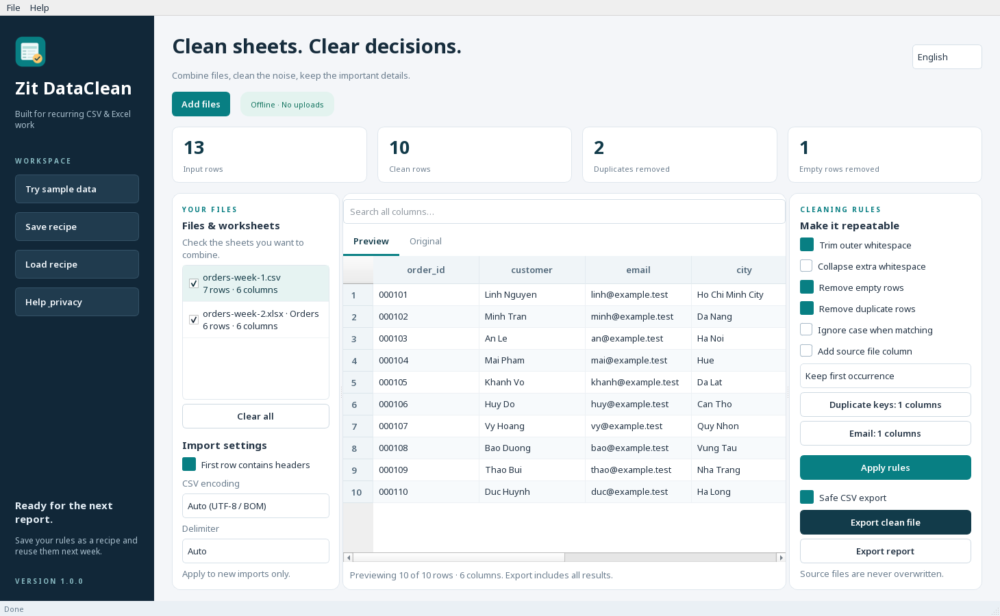

# Zit DataClean — Support

**Offline CSV & Excel cleanup for Windows**, published by **Zit Developer**.

Combine selected CSV/XLSX worksheets, remove duplicate and empty rows, normalize
whitespace, and save reusable cleanup recipes. Preview the results and export a
new CSV or text-typed Excel workbook. Your source files stay intact.

The app is being prepared for Microsoft Store certification. This page does not
claim it is already available for purchase. The final Store link will be added
after certification; no unofficial purchase link is required.

- [Privacy policy](PRIVACY.md)
- [Hướng dẫn tiếng Việt](FIRST_RUN_VI.md)
- [Report a problem / Gửi lỗi](../../issues)

When requesting support, include your app version, Windows version, file format
and a short description of what happened. Share a small **redacted** example
only; do not upload personal, financial or confidential data to public issues.

The app handles table values. It does not preserve Excel formatting, macros,
charts or formula calculation. XLSX export stores values as text; convert numeric
columns in Excel if you need calculations. Preview/search covers the first 5,000
rows; export includes all processed rows. Supported inputs: CSV, TSV, TXT and XLSX.

No accounts, analytics, ads, subscriptions or cloud upload are included in v1.
Microsoft handles purchases and updates when the app is distributed via Store.

© 2026 Zit Developer.
